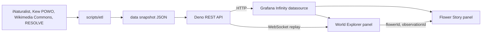

# BloomAtlas · Hidden Flora of the World

SEN0415 Advanced Web Programming · Final Project (Grafana plugins)

**Group:** BloomAtlas

| Member | Student number | Plugin |
|---|---|---|
| Samira Porduğan | 2300006029 | Flower Story |
| Tuğçe Topuz | 2200004231 | World Explorer |

BloomAtlas is a global flower atlas inside Grafana. You explore real, openly licensed flower observations on a world map, pick one, and open its story: photo and credit, name origin, regional flowering season, habitat and similar flowers.

---

## Plugins

| Plugin | ID | Shows | What it does |
|---|---|---|---|
| World Explorer | `tugcetopuz-bloomatlasworld-panel` | `Developed by Tuğçe Topuz` | World map of iNaturalist observations, filters (continent, biome, month, species), zoom and pan, observation insights, comparison of two observations, WebSocket replay, link to Flower Story |
| Flower Story | `samirapordugan-bloomatlasstory-panel` | `Developed by Samira Porduğan` | Story page for one species: observation photo with credit, reference gallery, name origin, regional flowering evidence, habitat (Kew POWO), Bloom Oracle similar flowers, link back to World Explorer with the filters kept |

Both are custom Grafana panel plugins written in TypeScript and React. The main content of every dashboard comes from these two panels.

---

## Architecture



- `scripts/etl/`: Python scripts that collect and check the data (licenses, research grade, open location).
- `packages/contracts/`: shared data types and validation used by the API.
- `api/`: Deno REST API (`/v1/species`, `/v1/observations`, `/v1/filters`, `/v1/stories`, `/v1/gallery`) and the WebSocket replay (`/v1/replay`).
- `plugins/`: the two panel plugins.

---

## Quick start

Requirements: Docker Desktop (on Windows with WSL 2) and an internet connection for the first run.

```bash
git clone https://github.com/TUGW59/grafana-project.git
cd grafana-project
docker compose up
```

The first run builds both plugins and downloads Grafana, which takes a few minutes. When Grafana is ready, open:

- World Explorer: http://localhost:3400/d/bloomatlas-world-preview
- Flower Story: http://localhost:3400/d/bloomatlas-story-preview

Dashboards open without logging in. To edit panels, sign in as `admin` / `admin`.

Stop with `Ctrl+C`, then `docker compose down`.

Ports 3400 (Grafana) and 18183 (API) must be free. The WebSocket replay only works on these ports.

## How to use

1. Open World Explorer. Filter by continent, biome, month or species.
2. Hover or click an observation on the map to see its details. Use the map buttons to zoom and pan.
3. Press **Play** in the replay box to stream the recorded observations one by one.
4. Open **Flower Story** for the selected observation.
5. In Flower Story, switch between reference photos, read the name origin and regional flowering notes, and open **Why this result?** under Bloom Oracle.
6. Use **Back to World Explorer** to return with your filters kept.

---

## Data sources and licenses

| Data | Source | License and credit |
|---|---|---|
| Observations and observation photos | [iNaturalist](https://www.inaturalist.org) | Only CC0 and CC BY observations and photos, research grade, open location. Every photo shows its owner and license and links to the original observation. |
| Botanical profiles (family, growth form, climate, native range) | [Kew Plants of the World Online](https://powo.science.kew.org) | Linked per species |
| Reference photos | [Wikimedia Commons](https://commons.wikimedia.org) | Only CC BY and CC BY-SA. Author, license and original file are linked under each photo. |
| Name origins | Sources found through [Wikidata](https://www.wikidata.org) | Publisher and access date shown under each text |
| Regional flowering and cultural notes | Per species, for example [Woodland Trust](https://www.woodlandtrust.org.uk) | Source link shown under each note |
| Biomes and ecoregions | [RESOLVE Ecoregions 2017](https://ecoregions.appspot.com) | CC BY 4.0 |

Notes:

- Observation dates are not used as flowering evidence.
- Traditional uses are shown as they were recorded in the sources. Nothing in BloomAtlas is medical advice.

---

## Bonus Claims

| Bonus | What we did | Where |
|---|---|---|
| Datasource usage | Infinity datasource reads our Deno API | `provisioning/datasources/infinity.yaml` |
| Datasource operations | Dashboard variables send continent, biome, month and species as query parameters; the API filters on the server | `api/src/app.ts`, `dashboards/world-explorer.json` |
| Panel operations | World: filters, hover, click, zoom, pan, focus, insights, comparison, panel options. Story: panel options (show sources, mock mode), responsive layout, gallery switching, links between the two panels | `plugins/*/src/components/` |
| AI | Bloom Oracle: weighted nearest-neighbor similarity over family, growth form, climate and native regions, with an explanation for every result and a benchmark against a simple baseline | `plugins/samirapordugan-bloomatlasstory-panel/src/utils/bloomOracle.ts`, `oracleBenchmark.ts`, `docs/ai-evaluation.md` |
| WebSocket | **Replay** of recorded observations, not live data. The API sends one observation every 400 ms; the map highlights it | `api/src/replay.ts`, `plugins/tugcetopuz-bloomatlasworld-panel/src/components/ObservationReplay.tsx` |
| Tests | Unit tests for both plugins, the API, the contracts and the data scripts, run by GitHub Actions on every pull request | `.github/workflows/ci.yml` |
| GitHub | Public repository with pull requests | https://github.com/TUGW59/grafana-project |
| Documentation | This README | `README.md` |
| Good code | TypeScript types, separate adapters, components and utils, shared contracts, lint and typecheck in CI | whole repository |
| YouTube | Demo video |  |

---

## Running the tests

```bash
cd plugins/samirapordugan-bloomatlasstory-panel && npm ci && npm run test:ci
cd ../tugcetopuz-bloomatlasworld-panel && npm ci && npm run test:ci
cd ../../api && deno task test
cd .. && deno test --allow-read packages/contracts/tests/
python3 -m unittest discover -s scripts/etl -p "test_*.py"
```

---

## Screenshots

---

## Known limitations

- The WebSocket feed is a replay of recorded observations, not a live stream.
- The data set is a small, hand-checked selection of species, not all flowers in the world.
- Bloom Oracle compares the botanical features we have; it is not species identification.
